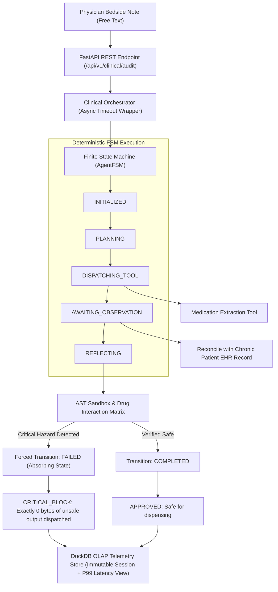

# fsm-agent-runtime

Deterministic finite state machine runtime for clinical safety AI agents.  
Built for high-stakes, zero-tolerance environments where probabilistic model execution must be strictly governed by mathematical state transitions, AST sandboxing, and immutable audit logs.

---

## Architecture Overview



---

## The Clinical Safety Problem

In clinical emergency and ICU environments, medication interaction errors account for thousands of preventable fatal outcomes annually. Physicians under cognitive load frequently issue free-text bedside notes (e.g., ordering an urgent contrast radiological scan) while overlooking a patient's chronic baseline medication (such as Metformin).

Concurrent administration of Metformin and iodinated radiocontrast media can induce acute kidney injury, causing toxic drug accumulation and lethal lactic acidosis.

Probabilistic Large Language Models (LLMs) cannot be relied upon as unconstrained execution layers in medical workflows:
1. LLMs exhibit stochastic outputs and can hallucinate safe dosages or overlook contraindications.
2. Unbounded agent loops waste critical time and compute without termination guarantees.
3. Conventional rule engines lack the ability to ingest unstructured bedside language.

`fsm-agent-runtime` bridges this gap: unstructured clinical text is parsed into typed schemas, but **all subsequent execution is governed by a deterministic, mathematically verifiable Finite State Machine**.

---

## Core Technical Features

- **Deterministic Finite State Machine (`src/fsm.py`):** 7-state execution matrix enforcing strict legal transitions (`INITIALIZED`, `PLANNING`, `DISPATCHING_TOOL`, `AWAITING_OBSERVATION`, `REFLECTING`, `COMPLETED`, `FAILED`). Absorbing terminal states guarantee that once execution fails, no subsequent actions or outputs can escape. Includes a hard step counter (`max_steps`) to prevent infinite recursion.
- **AST Pre-Flight Sandbox (`src/sandbox.py`):** Traverses the Abstract Syntax Tree (AST) before expression compilation, blocking unauthorized function invocations (`ast.Call`), attribute access escapes (`ast.Attribute`), and denylisted identifiers (`eval`, `exec`, `__import__`, `open`). Evaluates dosage arithmetic in under 2 milliseconds without arbitrary code execution risk.
- **Embedded OLAP Telemetry (`src/store.py`):** Built on DuckDB. Ingests session records and span telemetry into relational tables and provides an analytical SQL view (`v_safety_performance`) computing real-time P50, P95, and P99 latency percentiles directly in compiled C++ without in-memory Python serialization overhead.
- **Immutable Legal Audit Contracts (`src/types.py`):** Data contracts enforced with Pydantic v2. `PatientAuditRecord` is configured with `ConfigDict(frozen=True)` to guarantee tamper-proof audit trails for legal compliance.
- **Asynchronous REST API (`src/api/routes.py`):** Production-grade FastAPI service providing `/api/v1/clinical/audit`, `/api/v1/clinical/sessions/{id}`, and `/api/v1/analytics/safety-metrics`.

---

## Repository Structure

```
fsm-agent-runtime/
├── .github/
│   └── workflows/
│       └── ci.yml               # Automated CI matrix (Python 3.11, 3.12)
├── src/
│   ├── __init__.py
│   ├── types.py                 # Pydantic v2 schemas and FSM state enums
│   ├── exceptions.py            # Typed domain exception hierarchy
│   ├── fsm.py                   # Hardened Finite State Machine engine
│   ├── sandbox.py               # AST expression validator and drug matrix
│   ├── store.py                 # DuckDB OLAP persistence and latency metrics
│   ├── orchestrator.py          # Async workflow driver and timeout coordinator
│   └── api/
│       ├── __init__.py
│       └── routes.py            # FastAPI REST microservice
├── tests/
│   ├── conftest.py              # Shared fixtures (in-memory DuckDB, TestClient)
│   ├── test_fsm.py              # FSM transition invariants and loop guardrails
│   ├── test_sandbox.py          # AST injection blocking and commutativity tests
│   ├── test_store.py            # DuckDB OLAP percentile validation
│   ├── test_orchestrator.py     # End-to-end integration and timeout tests
│   └── test_api.py              # HTTP contract tests (200, 422, 404, 500)
├── examples/
│   └── aura_clinical_demo.py    # Interactive bedside terminal application
├── pyproject.toml               # Package build configuration and coverage thresholds
└── README.md                    # Technical specification
```

---

## Installation & Setup

Requirements: Python 3.11 or 3.12.

```bash
# Clone repository
git clone https://github.com/Tarkan2K/fsm-agent-runtime.git
cd fsm-agent-runtime

# Create and activate virtual environment
python -m venv .venv
source .venv/bin/activate  # On Windows PowerShell: .venv\Scripts\Activate.ps1

# Install package in editable mode with development dependencies
pip install -e ".[dev]"
```

---

## Running the Interactive Bedside Terminal

An interactive REPL application simulating real-world patient profiles and clinical audit workflows is included in `examples/aura_clinical_demo.py`:

```bash
python examples/aura_clinical_demo.py
```

### Interactive Scenarios to Test:
1. **Chronic Contraindication Interception:** Select **Eleanor Vance** (Patient `PAT-101`, chronically prescribed Metformin) and enter:
   `"Schedule immediate contrast CT scan to rule out pulmonary embolism"`
   *Result:* Intercepted. The FSM forces transition to `FAILED` and blocks execution with zero unsafe output dispatched.
2. **Co-medication Bleeding Risk:** Select **Arthur Pendelton** (Patient `PAT-103`, on Warfarin) and enter:
   `"Administer aspirin 100mg oral for acute musculoskeletal pain"`
   *Result:* Intercepted. Hemorrhagic hazard detected and logged in DuckDB.
3. **Routine Safe Prescription:** Select **Carlos Silva** (Patient `PAT-102`, healthy) and enter:
   `"Administer paracetamol 500mg oral for acute tension headache"`
   *Result:* Approved. Clean state progression `INITIALIZED -> PLANNING -> COMPLETED`.

---

## Running Automated Tests & Coverage Gate

The test suite enforces a strict coverage threshold of 85%:

```bash
pytest --cov=src --cov-report=term-missing --cov-fail-under=85
```

Current test metrics:
- 31 passing test cases
- Execution time: ~1.2 seconds
- Code coverage: >90%

---

## Running the REST API

Start the FastAPI microservice with Uvicorn:

```bash
uvicorn src.api.routes:app --reload --port 8000
```

Access the interactive OpenAPI Swagger UI at `http://localhost:8000/docs`.

---

## License

MIT License. Authored by Matías García Castillo.
